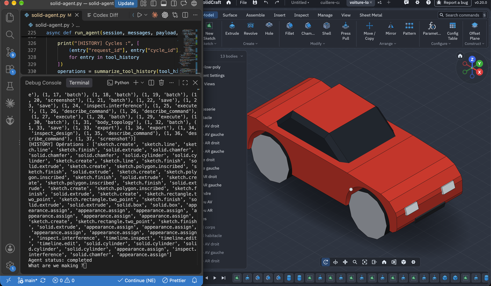

# Solid Agent

A command-line Python agent that connects an LLM to Solidcraft's CAD tools through MCP (Model Context Protocol).

I built this project **from scratch** to understand how an agent works and interacts with an MCP server. The agent loop is implemented directly in Python, covering tool discovery, model requests, tool execution, and feeding results back into the conversation.

## Demo
https://github.com/user-attachments/assets/5ee426fb-93e3-4507-aab7-c3a92fdd82e9



*1 shot prompt : build a low poly car*

## Getting started

You need Python, `solidcraft-cli` on your PATH, a running Solidcraft instance, and a Chat Completions-compatible API with tool calling support.

```bash
pip install -r requirements.txt
cp config.example.py config.py
```

Edit `config.py` to set your API URL, model, Solidcraft connection address, and allowed directory, then run:

```bash
Solidcraft --control 7878 &
python solid-agent.py
```

Enter a request in the terminal, or type `exit` to quit.
